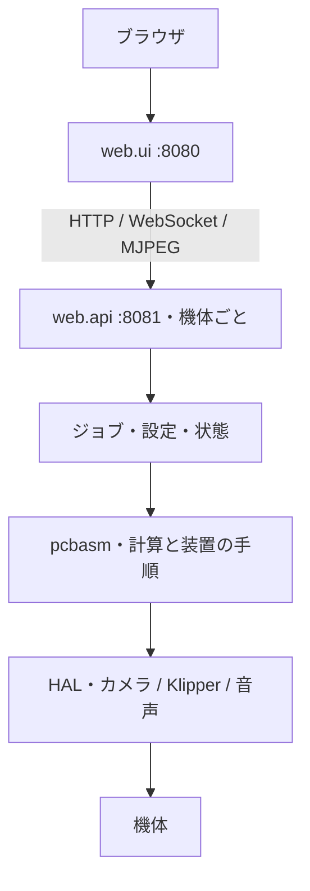

# アーキテクチャ

[ドキュメント一覧](../../README.md) · [開発の手引き](index.md)

装置制御の Python コア（`pcbasm`）と、2 つの FastAPI プロセス（`web.api` と `web.ui`）で構成する。
機体固有の状態は backend に集め、frontend は LAN 上の複数の backend を切り替えて表示する。



## 層と依存方向

上の層は下の層だけを import できる。
規則は [`tests/test_architecture.py`](../../tests/test_architecture.py) が import を ast で解析して検査する。規則の正典はそのテストの `_RULES` で、違反を見逃す許可リストは空にしてある。

```text
pcbasm
  L0  geometry  gcode  errors  document  atomic  paths  plotting  validators（atomic・paths・validators は標準ライブラリだけに依存する）
  L1  config(→pasting.params)   board   vision   hal(→vision.image。config は import しない)
  L2  kicad(→board。pcbnew はここだけ)   machine(→config, hal, vision)   migrate(→config)
  L3  align(→machine, hal, vision, board, config)
  L4  pasting(→align, machine, kicad, vision, hal, board, config)   pnp（pasting と同じ。互いに import しない）
  L5  commissioning(→pcbasm のすべて)
web
  process（標準ライブラリだけ）   contract（pydantic と標準ライブラリだけ）
  selfupdate(→contract, process, pcbasm.atomic, pcbasm.paths)
  api(→pcbasm, contract, selfupdate, process)
  ui(→contract, selfupdate, process, pcbasm.atomic, pcbasm.paths)
  dev(→pcbasm.atomic, pcbasm.paths)
```

`pcbasm.pasting.params`（塗布パラメータの値型）は L0 だけに依存し、`pcbasm.config` から import される。
`pcbasm` は `web` を import しない。ジョブの画面や API が変わっても、位置合わせや塗布計画の計算はコア層で検証できる。
`web.ui` と `web.selfupdate` は `web.api` を import せず、共有するものは `web.contract` に置く。

## 責務と変更先

| 配置                                | 責務                                                                                             |
| ----------------------------------- | ------------------------------------------------------------------------------------------------ |
| `src/pcbasm/geometry/`              | 座標変換、ポリゴン、経路、配置の計算                                                             |
| `src/pcbasm/plotting.py`            | 描画の共通部品（Agg、穴付きポリゴン、基板外形、PNG 保存）。図そのものは使う側のパッケージに置く  |
| `src/pcbasm/config/`                | `machine.toml` のスキーマ（TOML の 1 節が 1 モジュール）と読み込み、設定ページの項目、機体の機能 |
| `src/pcbasm/migrate/`               | `machine.toml` の冪等な移行（起動時に走り、先にスナップショットを取る）                          |
| `src/pcbasm/board/`                 | 基板データ（外形・部品・パッド・銅箔）と CSV / JSON の書き出し、全体図の描画                     |
| `src/pcbasm/kicad/`                 | KiCad 読込・生成、footprint、単位変換（pcbnew はここだけ）                                       |
| `src/pcbasm/vision/`                | カメラ校正、画像・銅箔・塗布点の検出                                                             |
| `src/pcbasm/hal/`                   | カメラ、Klipper、ステージ、ディスペンサー、音声の抽象と実装、fake                                |
| `src/pcbasm/machine/`               | 装置の組み立て、G-code ジャーナル、操作パネルの命令、駐機、装置診断                              |
| `src/pcbasm/align/`                 | 基板の位置合わせ、基準点、補正、カメラと装置の座標対応                                           |
| `src/pcbasm/pasting/`               | 塗布の設定解決、経路、高さ面、機械手順、画像収集、塗布量校正                                     |
| `src/pcbasm/pnp/`                   | 部品実装（Pick and Place）の置き場所。いまは中身が無い                                           |
| `src/pcbasm/commissioning.py`       | 立ち上げ手順の表と、各段が済んだかの判定（`GET /api/readiness`）                                 |
| `src/web/api/routers/`              | HTTP 入出力とコア呼び出し、例外から HTTP 応答への変換                                            |
| `src/web/api/jobs/`                 | 長時間処理、進捗、中断、操作者への質問、成果物の公開                                             |
| `src/web/ui/`                       | マシン探索・選択、SSR ページ、backend への中継                                                   |
| `src/web/ui/templates/` / `static/` | HTML、CSS、DOM 操作、API 応答の表示                                                              |
| `src/web/selfupdate/`               | backend / frontend 共通の Git 更新とサービス再起動手順                                           |
| `src/web/contract/`                 | backend・frontend・自己更新が共有する応答モデルとワイヤ定数                                      |
| `src/web/process.py`                | backend / frontend 共通の env 読み取りと logging の初期化                                        |
| `install.sh`、`deploy/`             | ホストの導入（段ごとに冪等）と、unit・sudoers・機種のテンプレート・firmware の雛形               |

パッケージの中の構成は、各パッケージの README にある（[align](../../src/pcbasm/align/README.md)、[geometry](../../src/pcbasm/geometry/README.md)、[hal](../../src/pcbasm/hal/README.md)、[machine](../../src/pcbasm/machine/README.md)、[pasting](../../src/pcbasm/pasting/README.md)、[pnp](../../src/pcbasm/pnp/README.md)、[vision](../../src/pcbasm/vision/README.md)）。

## 機体の機能は machine.toml の節で表す

機体が何をできるかは、`machine.toml` の節の有無で決まる。種別を表すキーは持たない。

| 節         | 機能                   | 読み込んだ値           |
| ---------- | ---------------------- | ---------------------- |
| `[solder]` | はんだ塗布（`solder`） | `MachineConfig.solder` |
| `[pnp]`    | 部品実装（`pnp`）      | `MachineConfig.pnp`    |

両方あれば両方使える機体で、どちらも無い `machine.toml` は設定エラーになる。
機能の判定は節の有無だけを根拠にする（読み込めば `MachineConfig.solder` / `pnp` が None でないことと同じ）。
backend は起動したときの節で機能を決め（`MachineConfigFile.capabilities`。検証の前の内容から決めるので、設定エラーの間も節があればその機能がある）、次のものをそれで分ける。
節を足したり外したりしたら backend を再起動する。

- ジョブ: `src/web/api/jobs/catalog.py` の `default_catalog` が、塗布のジョブを solder 機能の機体にだけ登録する
- API: `src/web/api/app.py` が、`routers/pasting/` を solder 機能の機体にだけ置く
- 申告: `GET /api/session/machine-info` の `capabilities` と、mDNS の TXT の `caps`
- 画面: `src/web/ui/features.py` の各ページの `capability` で、タブ・サイドバー・着地点を絞る。機体に無い機能のページはその機体の着地点へ 307 する
- 立ち上げ: `pcbasm.commissioning` の共通の段（`COMMON_STEPS`）に、機能ごとの段（`CAPABILITY_STEPS`）を続ける
- 設定ページ: 無い機能の節の項目は出さず、書き込みも受け付けない

塗布の処理は登録の時点で振り分けてあるので、`[solder]` が無いことを各所で確かめない。
ジョブは `JobContext.solder`、router は `MachineConfig.require_solder()` で `[solder]` を受け取る。
どの機体にもある処理で塗布の値を使うもの（終了時の駐機、装置診断のディスペンサー）だけが `machine.solder` の有無を見る。

### PnP を足すときの変更先

PnP の中身は、塗布と同じ形で次の場所に足す。

1. `src/pcbasm/pnp/` に計算と機械手順を置く。`pcbasm.pasting` とは互いに import しない（`tests/test_architecture.py` が確かめる）
2. `src/pcbasm/config/pnp.py` の `PnpConfig` に `[pnp]` の項目を足す。設定ページに出すなら `MachineConfig.pnp` に `section` の metadata を付ける
3. `src/web/api/jobs/pnp/` にジョブを置き、`default_catalog` の `if "pnp" in capabilities:` の下で登録する。API の router も `app.py` で同じ条件で置く
4. `src/web/ui/features.py` の「部品実装」タブ（`pnp`）にページを `capability="pnp"` で足し、準備中のページ（`placement`）を置き換える
5. 立ち上げの段を `pcbasm.commissioning` の `CAPABILITY_STEPS["pnp"]` に足し、[立ち上げ](../commissioning.md) の表にも足す
6. 部品実装機の雛形 `deploy/templates/usaremino_pnp/` の `machine.toml` と `printer.cfg` に、PnP のハードウェアの設定を足す

## 機能 → コードの地図

画面の機能 1 つは、URL `/m/{machine_id}/{slug}` の slug で辿れる。
ジョブのページでは slug がジョブ名とジョブのファイル名を兼ね、`grep -rn <slug> src` で画面からジョブ、`pcbasm` の手順まで辿れる。
ジョブでないページは、表の router の API を JS から呼ぶ。
表の並びは機能表（`src/web/ui/features.py` の `FEATURES`）と同じで、テストが一致を確かめる。

| slug                       | タブ     | 入口（`src/web/api/` の下）                       | 主な `pcbasm` の手順                                                                                                                                                  | 主な設定の節                                              |
| -------------------------- | -------- | ------------------------------------------------- | --------------------------------------------------------------------------------------------------------------------------------------------------------------------- | --------------------------------------------------------- |
| `paste_solder`             | 塗布     | `jobs/pasting/paste_solder.py`                    | `pasting.plan.plan_paste`、`pasting.prepare.prepare_paste`、`pasting.purge_check.purge_with_cleaning`、`pasting.paste_volume.runtime_correction.run_flow_calibration` | `[solder]`、`[alignment]`、`[probe]`、`[reference_point]` |
| `loading`                  | 塗布     | `jobs/pasting/loading.py`                         | `pasting.applicator.build_applicator`                                                                                                                                 | `[solder]`                                                |
| `height_plane`             | 塗布     | `jobs/pasting/height_plane.py`                    | `pasting.height`                                                                                                                                                      | `[probe]`                                                 |
| `nozzle_clean_test`        | 塗布     | `jobs/pasting/nozzle_clean_test.py`               | `pasting.nozzle_clean.plan_nozzle_clean`、`clean_nozzle`                                                                                                              | `[solder.nozzle.clean]`                                   |
| `placement`                | 部品実装 | なし（準備中のページ）                            | なし                                                                                                                                                                  | `[pnp]`                                                   |
| `commissioning`            | 校正     | `routers/readiness.py`                            | `commissioning.readiness`                                                                                                                                             | 全体                                                      |
| `camera_calibration`       | 校正     | `jobs/align/camera_calibration.py`                | `vision.calibration.CheckerboardCalibrator`                                                                                                                           | `[camera]`                                                |
| `camera_preview`           | 校正     | `routers/preview.py`                              | `machine.devices`                                                                                                                                                     | `[camera]`                                                |
| `reference_point_setup`    | 校正     | `jobs/align/reference_point_setup.py`             | `vision.marker.reference_marker_detector`                                                                                                                             | `[reference_point]`                                       |
| `board_tour`               | 校正     | `jobs/align/board_tour.py`                        | `align.board_frame.measure_board_frame`、`align.board.align_regions`、`refine_pad`                                                                                    | `[reference_point]`、`[alignment]`                        |
| `orthogonality_test`       | 校正     | `jobs/align/orthogonality_test.py`                | `align.orthogonality.OrthogonalityMetrics`                                                                                                                            | `[reference_point]`                                       |
| `copper_detection`         | 校正     | `routers/preview.py`、`routers/machine_config.py` | `vision.copper.CopperEdgeDetector`                                                                                                                                    | `[alignment]`                                             |
| `nozzle_cap`               | 校正     | `routers/pasting/nozzle.py`                       | `hal.stage.XYZStage`                                                                                                                                                  | `[solder.nozzle.cap]`、`[solder.nozzle.clean]`            |
| `probe_guide`              | 校正     | なし（説明のページ）                              | なし                                                                                                                                                                  | `[probe]`                                                 |
| `toolhead_offset`          | 校正     | `jobs/pasting/toolhead_offset.py`                 | `pasting.toolhead_offset.ToolheadOffsetProcedure`                                                                                                                     | `[solder.nozzle.offset]`                                  |
| `dispense_calibration`     | 校正     | `jobs/pasting/dispense_calibration.py`            | `pasting.dispense_calibration.procedure.FlowCalibrationProcedure`                                                                                                     | `[solder.dispenser]`、`[solder.motion]`                   |
| `paste_volume_calibration` | 校正     | `jobs/pasting/paste_volume_calibration.py`        | `pasting.dot_capture.DotCaptureRun`、`pasting.paste_volume.dataset`、`pasting.paste_volume.evaluate`                                                                  | `[solder.volume_correction]`                              |
| `paste_volume_refit`       | 校正     | `jobs/pasting/paste_volume_refit.py`              | `pasting.paste_volume.dataset.reader`、`pasting.paste_volume.fit`                                                                                                     | なし                                                      |
| `paste_dataset_finalize`   | 校正     | `jobs/pasting/paste_dataset_finalize.py`          | `pasting.paste_volume.dataset.store`、`pasting.paste_volume.dataset.pending`                                                                                          | なし                                                      |
| `paste_test_board`         | 基板     | `routers/pasting/test_board.py`                   | `pasting.test_board.generator`                                                                                                                                        | なし                                                      |
| `generate_grid_pcb`        | 基板     | `jobs/kicad/generate_grid_pcb.py`                 | `kicad.build.generate_grid_pcb`                                                                                                                                       | なし                                                      |
| `generate_rect_pcb`        | 基板     | `jobs/kicad/generate_rect_pcb.py`                 | `pasting.plate.write_rect_board`                                                                                                                                      | なし                                                      |
| `extract_pcb`              | 基板     | `jobs/kicad/extract_pcb.py`                       | `board.export`、`board.plot.render_pcb`                                                                                                                               | なし                                                      |
| `make_fill_coverage_pcb`   | 基板     | `jobs/kicad/make_fill_coverage_pcb.py`            | `kicad.build.build_fill_coverage_board`                                                                                                                               | なし                                                      |
| `klipper_status`           | 機体     | `routers/machine.py`                              | `machine.commands.to_gcode`                                                                                                                                           | `[klipper]`                                               |
| `machine_check`            | 機体     | `jobs/machine/machine_check.py`                   | `machine.diagnostics`                                                                                                                                                 | `[klipper]`、`[camera]`、`[audio]`                        |
| `machine_config`           | 機体     | `routers/machine_config.py`                       | `config.fields.setting_fields`                                                                                                                                        | 全体                                                      |
| `audio`                    | 機体     | `routers/audio.py`                                | `hal.audio`                                                                                                                                                           | `[audio]`                                                 |
| `config_history`           | 機体     | `routers/backup.py`                               | なし（`web/api/history.py` と `backup.py`）                                                                                                                           | 全体                                                      |

設定の節の中身は [設定キー一覧](../reference/config.md) にある。

## リクエストとジョブ

ページは `/m/{machine_id}/…`、機体の API は `/m/{machine_id}/api/…` を使う。
frontend の `MachineClient` が backend から表示用のモデルを取得し、
`pages.py` が `layout.py` の表示定義に従ってテンプレートへ渡す。

装置の状態、実効設定値、集計値は backend が返す。
frontend と JS はそれらを再計算しない。たとえばパッドの設定を編集したら、
サーバーが解決した応答か再取得した値で画面を更新する。

ジョブの公開名とパラメータは backend のカタログが管理する。
装置への変更操作は backend の操作権で調停され、閲覧者も緊急停止と中止を実行できる。
UI のボタン無効化だけに依存しない。

実行中の編集・対話コマンド・結果の反映や破棄には、ブラウザが表示しているジョブの
`expected_job_id` を渡し、backend が対象の一致を確認する。
ジョブが切り替わったら未送信の編集を破棄し、次のジョブへ持ち越さない。

## 機能を足すときの変更先

計算と装置の手順は先に `src/pcbasm/` へ置き、web 側には呼び出しと表示だけを足す。

### 機体の API を足す

1. `src/web/api/routers/` に router を書く。URL の prefix はファイルパスと同じにする（`routers/pasting/board.py` なら `/api/pasting/board`）。
2. `src/web/api/app.py` で router を登録する。
3. 装置や設定を変える endpoint には `ControlDep` を付ける。操作権のない要求は 423 になる。
4. 応答は `src/web/contract/models.py` の pydantic モデルで返す。

frontend 側の変更は要らない。`proxy.py` が `/m/{machine_id}/api/**` をそのまま backend の `/api/**` へ中継する。
JS からは `static/js/api.js` の `api()` に `/api/…` のパスを渡す。WS は `static/js/ws.js` の `connectEvents()` で張る。
JS に `fetch()` や `new WebSocket()` を直接書かない。機体の prefix が付かず、テストでも禁止している。
表示する文字列（座標・記録位置・操作権の状態など）は応答モデルに入れて返し、JS で組み立てない。

### ジョブを足す

ジョブは 1 ファイル 1 ジョブで、ファイル名をジョブ名（feature slug）と同じにする。
置き場所は、ジョブが呼ぶ `pcbasm` のドメインで決まる。

| 呼ぶドメイン     | 置き場所                    |
| ---------------- | --------------------------- |
| `pcbasm.align`   | `src/web/api/jobs/align/`   |
| `pcbasm.pasting` | `src/web/api/jobs/pasting/` |
| `pcbasm.kicad`   | `src/web/api/jobs/kicad/`   |
| `pcbasm.machine` | `src/web/api/jobs/machine/` |

1. ジョブのモジュールを作り、ジョブ関数と `register` を書く。関数は `JobContext` を受け取り、`pcbasm` を呼ぶ。ログ・進捗は `log` / `progress`、質問は `confirm` / `require` / `choose` / `ask_positive` で出す。
2. `register` で `JobDefinition` を登録する。`name` はファイル名と同じ文字列にする。装置を動かさないジョブは `uses_machine=False` にする。塗布の永続データ（基板ごとの塗布設定、dataset、塗布量校正）を使うジョブは `register` で `PasteStores` を受け取る。
3. `src/web/api/jobs/catalog.py` の `default_catalog` から `register` を呼ぶ。ここがジョブの一覧になる。機能の要るジョブは、その機能の条件の下で呼ぶ。
4. 次節「ページを足す」の手順で、ジョブのページを足す。ページに載っていないジョブがあるとテストが失敗する。

複数のジョブが使う台本の部品（基板の計測、マシン操作の command、ローディング、塗布量校正のフィットと報告）は `src/web/api/jobs/steps.py` に置く。ジョブのモジュールは別のジョブのモジュールを import しない。
実行基盤（1 枠のジョブ、`JobContext`、カタログ、終了時の駐機と通知音）は `src/web/api/jobs/runtime/` にある。

ジョブの開始・中止・結果の反映は `routers/jobs.py` の共通 API が扱う。ジョブごとの router は要らない。

### ページを足す

ページの URL は `/m/{machine_id}/{feature}` になる。feature slug はジョブ名と同じにする。
タブ・グループ・テンプレートは `src/web/ui/features.py` の機能表 `FEATURES` だけが持ち、ここに無い feature は 404 になる。

1. `FEATURES` に `Feature(slug, tab, group, template)` を 1 行足す。タブの中ではグループごとに表の順でサイドバーに並ぶ。機能の要るページには `capability` を書く。
2. テンプレートは `src/web/ui/templates/` の、呼ぶドメインのディレクトリ（`align/`、`pasting/`、`pnp/`、`machine/`）に置く。JS も `static/js/` の同じ名前のディレクトリに置く。
3. ページの種類に応じて、表示名とテンプレートを決める。

| ページの種類 | 表示名                                  | テンプレート                                                                                   |
| ------------ | --------------------------------------- | ---------------------------------------------------------------------------------------------- |
| ジョブ       | backend の `JobDefinition.label` を使う | `label` を書かない。汎用の `job.html`、`pasting/job.html`、`align/job.html` で足りる           |
| ジョブ以外   | `Feature` の `label` に書く             | `label` を書くとジョブ定義を取りにいかない（書かないと backend にジョブが無いため 503 になる） |

catalog のジョブと機能表の対応は `tests/web/ui/test_features.py` が確かめる。
作り直し前の URL（`/m/{machine_id}/{旧タブ}/{旧 slug}`）は、`features.py` の `LEGACY` で新しい URL へ 307 する。

入力欄は `templates/partials/forms.html` のマクロで描く。
ジョブのパラメータは `param_field`（`ParamSpec.group` のまとまりごとに並べるなら `param_sections`。`advanced` のまとまりは畳む）、
machine.toml の設定項目は `setting_input` を使い、ページごとに入力欄を書かない。
入力の即保存（machine.toml の設定欄、ジョブフォームの次回の既定値、パッド設定）は `api.js` の `pendingSaves` を通す。
ジョブを始める前に `job_console.js` がこれを送り終え、保存に失敗したら開始しない。

ページに追加の値が要るときは、次の順で足す。

1. backend の応答に無い値は、frontend で計算せず、backend の応答モデルに足す。
2. `pages.py` の `_FEATURE_CONTEXT` か `_JOB_FEATURE_CONTEXT` に、backend の応答からその値をテンプレートへ渡す処理を足す。

## 設定とデータの所有者

設定は backend が持ち、frontend 専用のホストは機体の `machine.toml` を読まない（読むのは `machines.toml` だけ）。
PCB の閲覧・アップロード先も backend のホストのファイルシステムである。
置き場所と環境変数は [ファイルと環境変数](../reference/files.md) にある。

永続ファイルの構造を変える場合は既存データの読込・移行を扱う。
ディレクトリ名だけを変更すると既存の運用データが読み込まれなくなるため、見た目だけの改名は行わない。
`tests/data/` のテスト資産と `deploy/templates/` の初期設定を実機データと混同しない。
